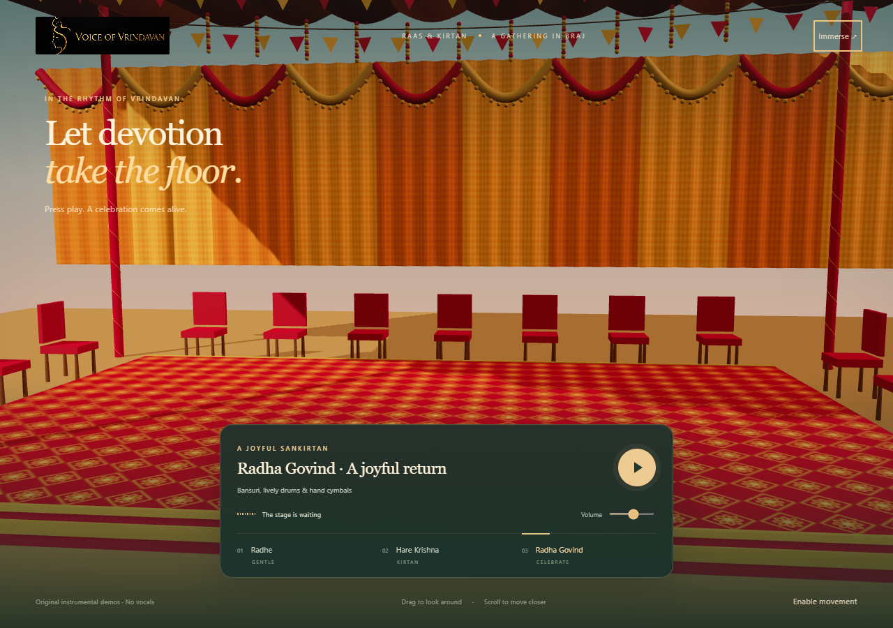

# Voice of Vrindavan

## GitHub review: the 3D Kirtan Courtyard

This branch contains a new 3D music experience for review. It has not been merged or deployed. The public `main` branch retains the original logo-only homepage described below.

Run `npm start` (no dependencies to install), then visit `http://127.0.0.1:8080/`. The 3D festival stage has three original instrumental demos, camera controls and reactive lights. The owner will add their own characters later; the default configuration is empty. See [the prototype guide](kirtan/README.md) and [the character setup guide](kirtan/models/README.md).

## Current public version

The public homepage displays only the supplied original gold logo PNG on black. It preserves the exact emblem, lettering and original composition on every screen. There are no chat controls, navigation, downloads, or model requests on this page.

Cloudflare Pages deploys this repository main branch. Previous website is preserved in Git history at 8a2d4ae and in a local backup. Old cloud data was not deleted.

CSS adds an initial fade and a gentle repeating light pulse without reconstructing, tracing or distorting the artwork. Reduced-motion preferences disable the animation. No JavaScript or WebGL is required. The 404 page uses the same presentation; existing old-page redirects still lead to the homepage.
